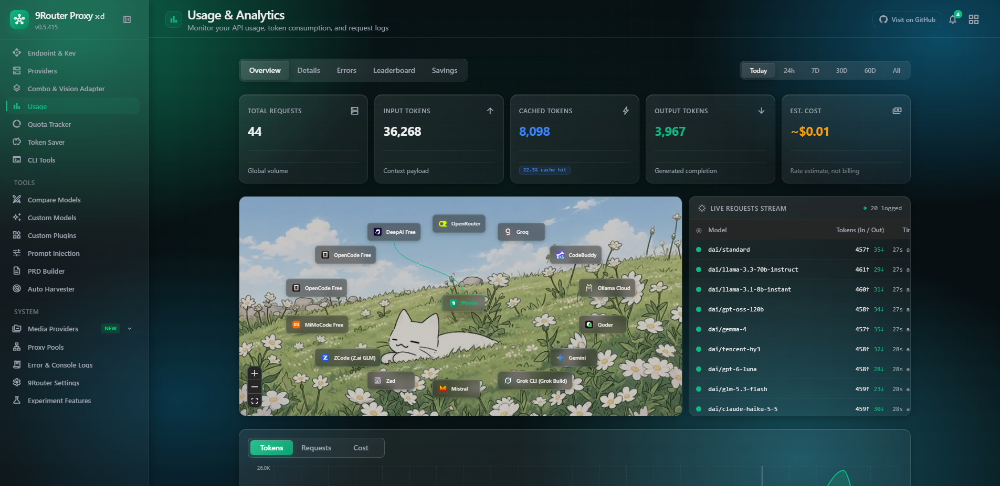

<div align="center">


A fork of [Decolua/9router](https://github.com/Decolua/9router) (`9router-xd`) with extra features, custom glass/cyan UI, and rough edges fixed for everyone.

One gateway, one API key, any model: an OpenAI-compatible endpoint that routes to Claude, GPT, Gemini, Kimi, Qwen, GLM, DeepSeek, Grok and many more, with OAuth or your own accounts.

[](https://www.npmjs.com/package/9router-xd)   

</div>

---

## Screenshots

<div align="center">



</div>

## Routing & Capabilities

9Router accepts requests in standard client formats (OpenAI Chat Completions, Anthropic Messages, or Gemini generateContent), translates them on-the-fly, and routes them to upstream providers through multiple connection tiers:

- **OAuth & Device Auth** - Connect official account sessions with automatic token refresh.
- **Direct API Keys** - Standard API key integration for enterprise and public AI cloud providers.
- **Free Tier Relay** - Zero-configuration routing for free developer and community AI gateways.
- **Web Cookie Sessions** - Reverse-engineered browser session adapters for direct consumer web platforms.
- **Local & Self-Hosted** - Connect local engines (Ollama, vLLM, LM Studio) and self-hosted instances.

Beyond text chat, the router natively exposes specialized endpoints for multimodal tasks: Text-to-Image, Image-to-Text, Video Generation, Text-to-Speech (TTS), Speech-to-Text (STT), Embeddings, and Web Search/Fetch.

## Architecture & Core Design

9Router functions as a unified gateway layer between AI client applications and model providers. It abstracts protocol differences, authentication mechanisms, and request lifecycle management so downstream tools only need to speak one standard interface.

- **Universal Protocol Adapter**: Ingests requests in OpenAI, Anthropic Claude, or Google Gemini format, translates them on-the-fly to the target provider's native schema, and transparently streams standardized responses back.
- **Unified Credential & Key Management**: Single interface for managing OAuth sessions, direct API keys, reverse-engineered web sessions, and custom local models.
- **Failover & Traffic Routing**: Dynamic routing policies including intelligent fallback chains, load balancing, model aliases, and latency-optimized dispatching.
- **Enterprise Controls**: Granular token quotas, rate limiting (RPM/TPM), budget caps, IP allowlisting, and automated state backups.

For granular version updates, newly added providers, and ongoing improvements, refer directly to [CHANGELOG_DAYY4DEV.md](./CHANGELOG_DAYY4DEV.md) and [CHANGELOG.md](./CHANGELOG.md).

## Getting started

### Quick Start via npm (Recommended)

Install globally from npm and start the gateway + dashboard:

```bash
npm install -g 9router-xd
9router-xd

# Or run directly without installing:
npx 9router-xd
```

Common CLI options:

```bash
9router-xd                  # Start with default settings (port 20128)
9router-xd --port 8080      # Custom port
9router-xd --no-browser     # Do not auto-open browser
9router-xd --skip-update    # Skip update check
9router-xd --help           # Show all options
```

### From Source (Developer)

```bash
git clone https://github.com/Dayy4dev/9router.git
cd 9router
npm install
npm run dev          # dashboard on http://localhost:20128
```

Production:

```bash
npm run build
npm run start
```

Docker:

```bash
docker build -t 9router-xd .
docker run -d -p 20128:20128 -v 9router-data:/app/data 9router-xd
```

Once it is running:

| | |
| --- | --- |
| Dashboard | `http://localhost:20128/dashboard` (first login: `ajasendiri`, or set `INITIAL_PASSWORD`) |
| OpenAI-compatible | `http://localhost:20128/v1` |
| Claude-compatible | `http://localhost:20128/v1/messages` |
| Gemini-native | `http://localhost:20128/v1beta/models/{model}:generateContent` |
| Health probe | `GET /api/health` |

Point any CLI tool or agent at the base URL, generate a key under **Endpoint & Key**, and you are done.

## Model names you can call

| Form | Example |
| --- | --- |
| Provider model | `kiro/claude-sonnet-4.5`, `kimi/kimi-k2.6`, `deepseek/deepseek-v4.1-pro` |
| Custom node | `mynode/gpt-oss-120b` |
| Combo | `my-combo` (fallback, round-robin, fusion and more) |
| Custom model | any name you define in Custom Models |

## Configuration

The app reads a few environment variables with sensible defaults; see [.env.example](./.env.example). State lives in `~/.9router` (SQLite database, backups, secrets).

## Credits & Acknowledgments

- **Upstream Project**: Built on **[Decolua/9router](https://github.com/Decolua/9router)** (and [serenhope/9router](https://github.com/serenhope/9router)) — full credit to upstream creators and contributors for the core router engine, provider adapters, and protocol translators.
- **CLIProxyAPI**: Full credit to **[CLIProxyAPI](https://github.com/router-for-me/CLIProxyAPI)** for the original Go implementation and architectural foundation.
- **xrouter**: Features, ZCode start plan / promo engine, and rate-limit mechanics ported from [xrouter](https://github.com/johsua092-ui/xrouter).
- **9router-xd Edition**: Maintained and developed by **[Dayy4dev](https://github.com/Dayy4dev)** with custom glass/cyan UI, PRD Builder, Prompt Injection, Proxy Harvester enhancements, dynamic auto-routing, and standalone `9router-xd` npm CLI distribution.
- **Releases & Changelog**: Tracked in [CHANGELOG_DAYY4DEV.md](./CHANGELOG_DAYY4DEV.md) and [CHANGELOG.md](./CHANGELOG.md).
- **License**: **MIT**, same as upstream. See [LICENSE](./LICENSE).

---

<div align="center">

If this fork helped you, a star is appreciated.

[](https://github.com/Dayy4dev/9router/stargazers)

</div>


